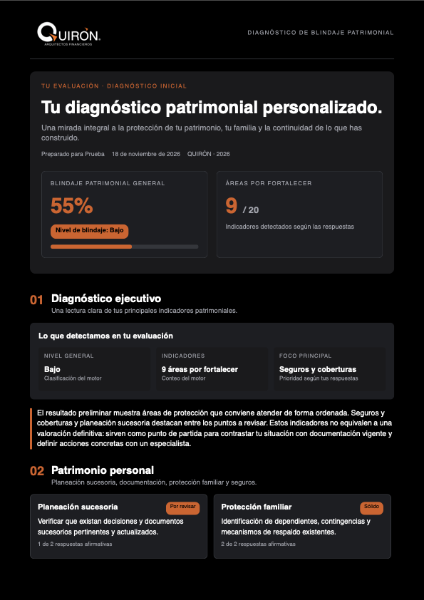
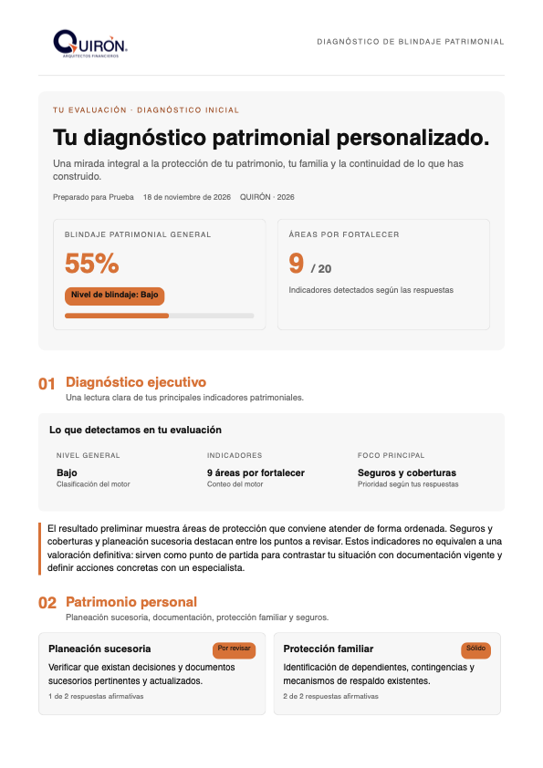
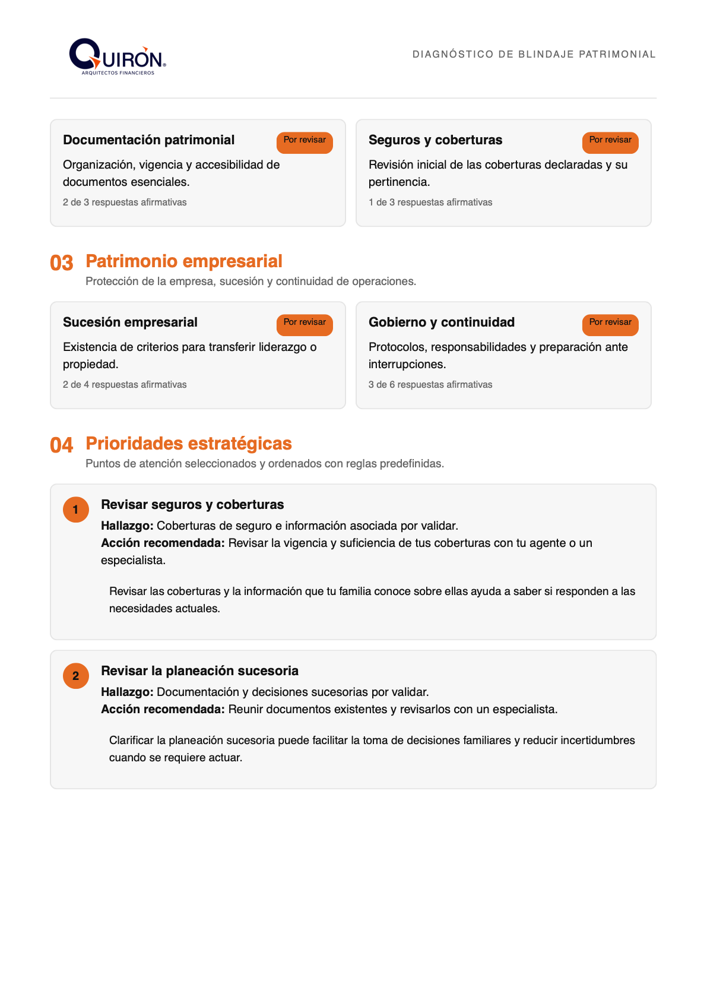
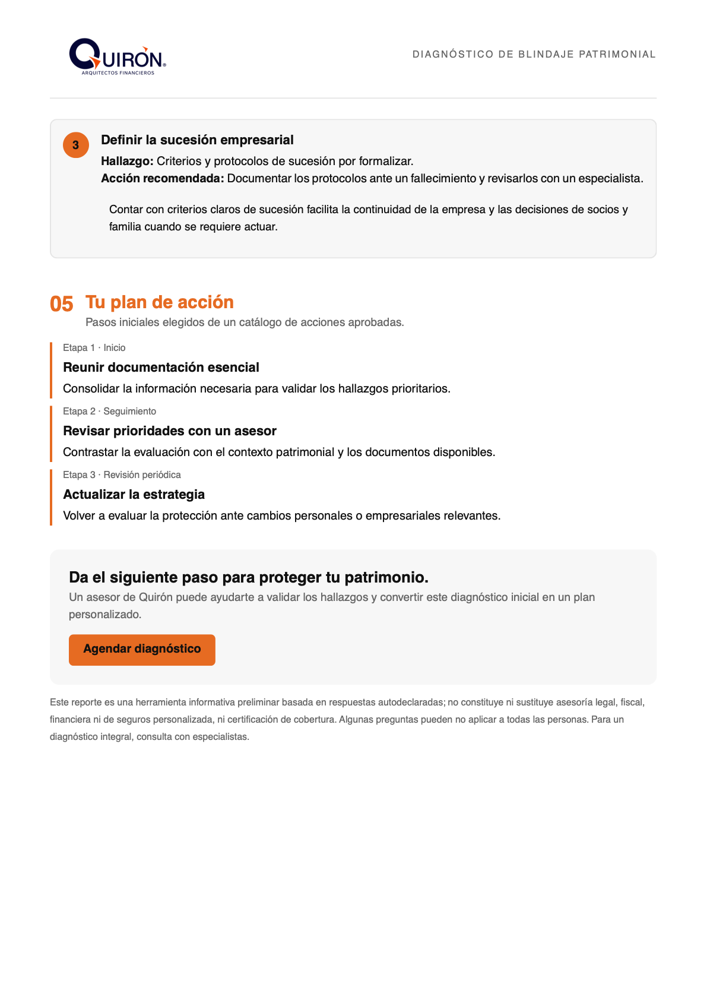

# Quirón light design review

The PDF images use the same sample report and personalized feedback. The first page of the prior and updated templates is shown below; pages 2 and 3 of the updated template are included for page-break review.

| Before                                     | After                                      |
| ------------------------------------------ | ------------------------------------------ |
|  |  |

The questionnaire landing screen was visually inspected as a static render of the production HTML and stylesheet. Browser screenshot export and an interactive check of answer selection and the results screen remain outstanding: the local Next.js server could not bind a port in the restricted environment (`EPERM` on `0.0.0.0:3000`). Review these states in the PR preview before approval.
